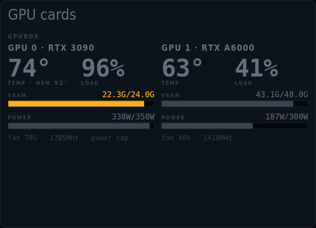
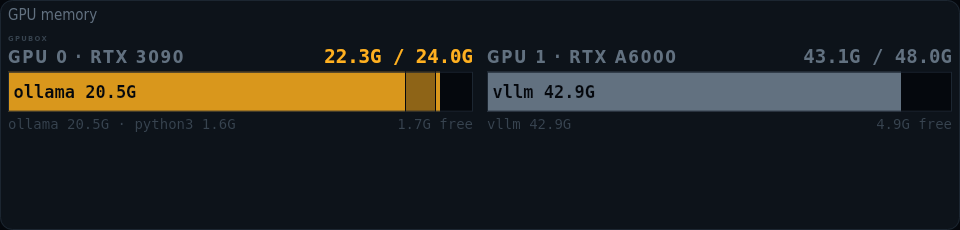
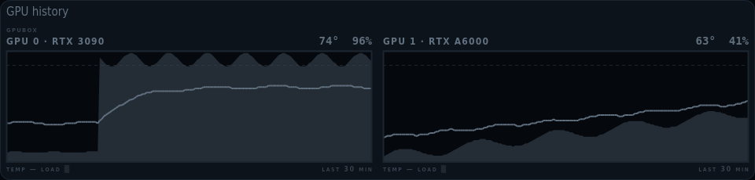

# kiosko-plugin-gpu

The GPUs of your AI box: temperature, load, VRAM by process and history. Local, over ssh or from a Prometheus exporter.

A plugin for [Kiosko](https://github.com/kiosko-lcd/kiosko), the widget mosaic for small USB LCD panels.



## Install

In Kiosko, **Plugins → Install from npm** → `kiosko-plugin-gpu`, then restart Kiosko. Or from a terminal:

```sh
npm install --prefix ~/.config/kiosko/plugins kiosko-plugin-gpu
```

(macOS: `~/Library/Application Support/Kiosko/plugins`, Windows: `%APPDATA%\Kiosko\plugins`.)

## Requirements

- A GPU and its tool: `nvidia-smi` (NVIDIA driver), `rocm-smi` or `amd-smi` (ROCm), or the amdgpu / i915 / xe drivers for sysfs readings. For another machine: key-based `ssh` to it (the CLIs run there), or a Prometheus URL serving [DCGM exporter](https://github.com/NVIDIA/dcgm-exporter) or [nvidia_gpu_exporter](https://github.com/utkuozdemir/nvidia_gpu_exporter) metrics.

## Widgets

### GPU cards — `gpu/cards`

One column per GPU: temperature, load, VRAM and power bars, fan and throttling. Dim until a threshold is crossed.


Uses: `gpu/devices`.

| Option | Type | Default | |
|---|---|---|---|
| `tempWarn` | number | `80` | Amber temperature |
| `tempAlert` | number | `90` | Red temperature. Of the core (the hotspot or memory sensor when there is no core one). The widget keeps the tile while a GPU is past it. |
| `vramWarn` | number | `90` | Amber VRAM from |
| `vramAlert` | number | `97` | Red VRAM from |
| `gpus` | list | `[]` | GPUs. Empty: all. Indexes or model names, comma-separated: * matches anything, a leading ! leaves out (0, 1, *4090*, !*A6000*). |

### GPU memory — `gpu/vram`

VRAM per GPU as a bar stacked by process (ollama, vllm, python…), with what is left free.



Uses: `gpu/devices`.

| Option | Type | Default | |
|---|---|---|---|
| `tempWarn` | number | `80` | Amber temperature |
| `tempAlert` | number | `90` | Red temperature. Of the core (the hotspot or memory sensor when there is no core one). The widget keeps the tile while a GPU is past it. |
| `vramWarn` | number | `90` | Amber VRAM from |
| `vramAlert` | number | `97` | Red VRAM from |
| `gpus` | list | `[]` | GPUs. Empty: all. Indexes or model names, comma-separated: * matches anything, a leading ! leaves out (0, 1, *4090*, !*A6000*). |
| `maxProcesses` | number | `4` | Processes per bar. The rest is grouped as "other". |

### GPU history — `gpu/history`

Temperature line over load area for the last minutes, per GPU, with the red temperature dashed.



Uses: `gpu/devices`.

| Option | Type | Default | |
|---|---|---|---|
| `tempWarn` | number | `80` | Amber temperature |
| `tempAlert` | number | `90` | Red temperature. Of the core (the hotspot or memory sensor when there is no core one). The widget keeps the tile while a GPU is past it. |
| `vramWarn` | number | `90` | Amber VRAM from |
| `vramAlert` | number | `97` | Red VRAM from |
| `gpus` | list | `[]` | GPUs. Empty: all. Indexes or model names, comma-separated: * matches anything, a leading ! leaves out (0, 1, *4090*, !*A6000*). |
| `historyMs` | duration (ms) | `1800000` | Time shown. Up to the history kept by the source. |

## Data sources

### GPUs — `gpu/devices`

Temperature, load, VRAM (and who holds it), power, fan and clocks per GPU, from this machine, another over ssh, or a Prometheus exporter. Read every 5 s while a widget uses it. Options are set once in Kiosko → Settings → Data sources.

| Option | Type | Default | |
|---|---|---|---|
| `backend` | `auto` \| `nvidia` \| `amd` \| `intel` \| `prometheus` | `"auto"` | Back end. auto tries the metrics URL (if set), nvidia-smi, rocm-smi / amd-smi and sysfs, in that order. |
| `ssh` | string | `""` | Read over ssh. Runs nvidia-smi / rocm-smi on that host with ssh -o BatchMode=yes: needs key login. Empty = this machine. |
| `url` | string | *(secret)* | Metrics URL. DCGM exporter (port 9400) or nvidia_gpu_exporter (port 9835). |
| `token` | string | *(secret)* | Metrics bearer token. Only if the metrics URL is behind auth. |
| `label` | string | `""` | Host label. Shown above the GPUs. Defaults to the ssh host. |
| `processes` | boolean | `true` | Per-process VRAM. One more nvidia-smi call per reading. |
| `historyMs` | duration (ms) | `1800000` | History kept. How far back GPU history can look. |

## Development

```sh
npm install
npm test          # node:test
npm run check     # TypeScript
npm run build     # dist/index.js, what Kiosko loads
```

To try it in a running Kiosko without publishing: `kiosko plugins link .` and restart Kiosko.

Working on Kiosko and its plugins together: clone them side by side
(`kiosko/` and `kiosko-plugins/kiosko-plugin-gpu/`) and run `npm install` in
`kiosko/`; its workspaces link every plugin found in `../kiosko-plugins`.

## License

MIT
